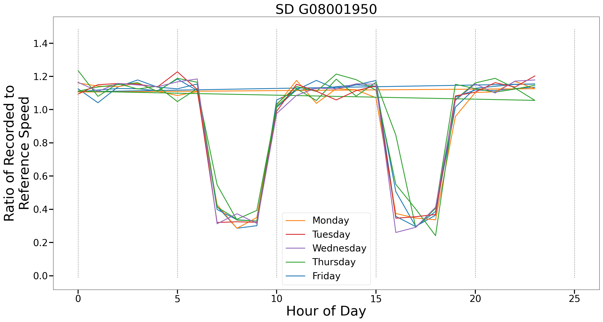

# Granularity Tree
Codebase for a knowledge graph-based approach for spatio-temporal data fusion.

# Data

The four case studies, with the exception of Case Study 2, relied exclusively on publically available data.  Below are links to individual datasets used in all case studies.

## Graph Building

There were several datasets used during for graph construction in one or more case studies.

**Geometries**: The geometries for the spatial entities were obtained from [NHGIS](https://www.nhgis.org/) as TIGER/Line shapefiles, using the files from the year 2023.  These files also contained GISJOIN ID assignments used throughout.

**Entity Matching**:  We obtained files that map one entity to another from two locations provided by the U.S. Census.  For block assignment files, we used the 2010 files from [here](https://www.census.gov/geographies/reference-files/time-series/geo/block-assignment-files.2010.html#list-tab-361828852).  For all other entity relationships, we used the 2020 files from [here](https://www.census.gov/geographies/reference-files/time-series/geo/relationship-files.2020.html#list-tab-1709067297).

**Population**: For the population data used in constructing the population-based weights, we obtained Census data for each state individually, from the following sources:
- [Connecticut](https://data.census.gov/table/DECENNIALPL2020.P1?q=population&g=040XX00US09$1000000)
- [Vermont](https://data.census.gov/table/DECENNIALPL2020.P1?q=population&g=040XX00US50$1000000)
- [Oregon](https://data.census.gov/table/DECENNIALPL2020.P1?q=population&g=040XX00US41$1000000)
- [Tennessee](https://data.census.gov/table/DECENNIALPL2020.P1?q=population&g=040XX00US47$1000000)
- [New York](https://data.census.gov/table/DECENNIALPL2020.P1?q=population&g=040XX00US36$1000000)
- [Minnesota](https://data.census.gov/table/DECENNIALPL2020.P1?q=population&g=040XX00US27$1000000)


## Case Study 1: Vehicle Charging

For the EV charging data, we used data for the city of [Palo Alto](https://www.kaggle.com/datasets/venkatsairo4899/ev-charging-station-usage-of-california-city).

## Case Study 2: Traffic Patterns

The data used for this case study was provided by [NTDAS](https://ntdas.ieee.org/).  This is the only commercial dataset used in this manuscript.  In lieu of providing the raw data, which is against licensing terms, we have provided a sample dataset with dummy data that can be used to run the example.  See instructions below.

## Case Study 3: Income vs. Green Policies

The state policy information was obtained from [XChange](https://www.climatepolicydashboard.org/policies), selecting the "download all policy data" option.  The income data was obtained from [the Census Bureau](https://data.census.gov/table?q=income&g=010XX00US$0500000&y=2024).  This link leads specifically to the county version; the state version can be selected by changing the filters.

## Case Study 4: Vehicle emissions

The population data used to build the graphs are linked above.  The original link we obtained emissions data from appears to now be defunct, but there is an identically named dataset published by the same source on the same website [here](https://catalog.data.gov/dataset/city-and-county-energy-profiles?from_hint=eyJxIjoiY2l0eSBhbmQgY291bnR5IGVuZXJneSBwcm9maWxlcyIsInNvcnQiOiJyZWxldmFuY2UifQ%3D%3D).  This appears to be the same data, though there is no guarantee.


We obtained ZIP code-level registration for Minnesota, Oregon, and Vermont and county-level registration for Tennessee from [AtlasHub](https://www.atlasevhub.com/market-data/state-ev-registration-data/), ZIP-code level registration for New York from [NYSERDA](https://www.nyserda.ny.gov/All-Programs/Drive-Clean-Rebate-For-Electric-Cars-Program/Rebate-Data/Data-on-Electric-Vehicles-and-Charging-Stations) (to get the correct years), and city-level registration for Connecticut from [Data.gov](https://catalog.data.gov/dataset/electric-vehicle-registration-data).


# Example

While the code for all case studies as well as links to the data are provided, we have also provided a bare-minimum working example.  This example can be found in [example.py](./src/example.py).  All of the filepaths used in the example are relative to the main repository directory.  To run the example, we suggest the user use Anaconda with the provided [env.yml](./env.yaml) to install the necessary packages.  We ran this code on Ubuntu 24.02.2.  To run the example, the following commands must be run:

```
conda create --file env.yml
python ./src/example.py
```

This example mimics Case Study 2.  We have provided sample data in [dummySample.csv](./data/ntdas/dummySample.csv) that reflects some of the information contained in the actual NTDAS dataset used.  It is important to note, however, that **this is randomly generated data.**  As the NTDAS dataset is commercial, we cannot provide the actual raw data, so we have generated arbitrary data for the sample.  The generation method is also found in [example.py](./src/example.py), though the current dummySample.csv file was used to generate the following plot:



The full results of the data displayed in this plot as well as all other Colorado school districs included in the sample can be found in [exampleResults.csv](./data/ntdas/exampleResults.csv).

We encourage the user to start by trying to run the example, the graph of which is also provided, in the [STEvalGraph](./graphs/STEvalGraph/) directory.  The user is then encouraged to look at [allEval.py](./src/allEval.py) for code on how each case study was run, as those provide more complex examples.


# License

This codebase is licensed under GNU AGPLv3.  Please see LICENSE for more information.
